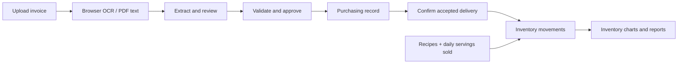

# Kitchen Ledger

A restaurant purchasing and inventory application that turns supplier invoices into reviewed purchasing records and confirmed stock movements. Built for restaurant owners who need to track ingredients, supplier prices, and daily recipe consumption.

**Public website:** [Open Kitchen Ledger](https://kitchen-ledger.neathaven3.chatgpt.site/)

The website can be opened without a GitHub account. Try the browser-local dummy workspace without configuring Supabase. Persistent records require an app account. Cloning this repository creates a separate installation: configure your own Supabase project using the steps below.

## Features

- Upload invoice images or PDFs; run English OCR and extract invoice details and line items.
- Review and correct extracted fields, inspect source evidence, and add suppliers or inventory items during review.
- Validate arithmetic, required fields, product matching, stock conversions, and duplicate supplier invoices.
- Approve purchasing records separately from receiving goods; only confirmed deliveries increase stock.
- Track stock counts, waste, kitchen usage, supplier returns, daily movements, and supplier price history.
- Save recipes, search and select dishes sold, enter servings, and deduct ingredients together in a transaction. Void a sales batch to restore its original ingredient quantities.
- Ask an optional Google Gemma assistant about an invoice's contents and calculations.
- Search long lists and browse 10 entries per page. Inventory item search controls the full date-range chart.
- Export approved invoices as CSV.

## How it works



The frontend uses plain JavaScript, HTML, and CSS. A small Node server serves the app locally and proxies optional AI requests. Supabase provides PostgreSQL, email/password authentication, protected database functions, and private invoice-file storage. Tesseract.js handles image OCR; PDF.js handles PDF text and scanned-page rendering.

## Run locally

Requirements: **Node.js 22 or newer**, Git, and a modern browser. OCR/PDF dependencies load from CDNs and need internet access.

```bash
git clone https://github.com/Michae1GitHub/kitchen-ledger.git
cd kitchen-ledger
node server.mjs
```

Open **http://127.0.0.1:4173**. No package installation is required to run the app. The dummy workspace works immediately and stores its records in this browser; it does not write to Supabase. **Connection & data → Reset dummy workspace** resets only those local sample records.

Do not open `web/index.html` directly or serve only the static files if you want AI Q&A: its `/api/invoice-chat` endpoint needs the Node server or the provided Worker build.

## Reproduce the Supabase setup

### 1. Create your own project and obtain public configuration

1. Sign in to the [Supabase dashboard](https://supabase.com/dashboard) and create a new project.
2. Wait for the database to finish provisioning.
3. In the project's **Connect** dialog or API settings, copy the **Project URL** and **publishable API key** (`sb_publishable_...`).
4. Edit [web/config.js](web/config.js), replacing only these two placeholder values:

```js
export const SUPABASE_URL='https://YOUR_PROJECT_REF.supabase.co';
export const SUPABASE_KEY='YOUR_SUPABASE_PUBLISHABLE_KEY';
```

Keep the remaining exports in that file; they derive the dashboard links from the URL. The frontend imports this file directly, so a `.env` file alone will not configure Supabase. Refresh the browser after saving.

The publishable key is intended for browser use; authentication, Row Level Security, and protected RPCs control access. **Never put a database password, secret key, or `service_role` key in this file.** See [Supabase's API key documentation](https://supabase.com/docs/guides/getting-started/api-keys).

### 2. Apply both migrations, in order

Open your project's **SQL Editor → New query**. Copy the complete contents of each file into a query and click **Run**:

1. [001_restaurant_ledger.sql](supabase/migrations/001_restaurant_ledger.sql)
2. [002_recipes_and_sales.sql](supabase/migrations/002_recipes_and_sales.sql)

Run each migration **once**, waiting for the first to succeed before running the second. `Success. No rows returned` is the expected result. These scripts contain transactions and target a fresh Supabase project; they are not repeatable reset scripts. For an existing v1 installation, run only migration 002. It retains existing invoices and stock.

The migrations create:

| Area | Database/storage objects |
| --- | --- |
| Suppliers and inventory | `ledger_suppliers`, `ledger_products` |
| Purchasing | `ledger_invoices`, `ledger_invoice_items` |
| Stock and audit | `ledger_movements`, `ledger_events` |
| Recipes and sales | `ledger_recipes`, `ledger_sales_batches`, `ledger_recipe_sales` |
| Protected API | `ledger_state()` and `ledger_action(text, jsonb)` |
| Original documents | Private Storage bucket named `invoices` |

Each authenticated app user owns a separate workspace. Reads are restricted by owner. Direct browser table writes are revoked; database functions validate and post changes. Storage paths start with the owner's user ID. The private bucket permits supported invoice types up to 20 MB. Do not make the bucket public or add permissive write policies to work around an error.

To inspect the setup in SQL Editor:

```sql
select tablename, rowsecurity
from pg_tables
where schemaname = 'public' and tablename like 'ledger_%'
order by tablename;

select id, public, file_size_limit
from storage.buckets
where id = 'invoices';

select to_regprocedure('public.ledger_state()') as state_function,
       to_regprocedure('public.ledger_action(text,jsonb)') as action_function;
```

Expect ledger tables with RLS enabled, a bucket with `public = false`, and both function names. Business functions require an authenticated app user, so an unauthenticated `ledger_state()` call is not a useful setup test.

### 3. Configure email/password sign-in

1. Under **Authentication**, enable the email provider/signups if disabled.
2. Keep **Confirm email** enabled so new accounts must verify their address before signing in. This is enforced by Supabase, not by an app-only checkbox.
3. Under **Authentication → URL Configuration**, set the **Site URL** to `http://127.0.0.1:4173` while testing locally. When you deploy your own copy, change it to that installation's HTTPS URL and configure any additional permitted redirect URLs.
4. Check email delivery settings if confirmation messages are not arriving. Hosted provider limits and SMTP requirements depend on your project configuration.

This app uses email/password sign-in; social login is not required. Signup and resend requests explicitly request the current app origin as the confirmation redirect, so it must be permitted by your project's URL configuration; otherwise Supabase can fall back to the Site URL. Account creation includes a matching-password check and a **Check your email** step. Users can resend a link after a 60-second cooldown, switch email addresses, or return to sign-in. Verification callbacks are checked against Supabase; tokens are removed from the address bar and are not used to sign in automatically. After confirming the email, sign in explicitly. Expired links show a resend option. Your Supabase dashboard login is separate from an application user. See [email/password authentication](https://supabase.com/docs/guides/auth/passwords) and [redirect URL configuration](https://supabase.com/docs/guides/auth/redirect-urls).

### 4. Connect the app and verify the workflow

1. Start `node server.mjs` and open the local URL.
2. Go to **Connection & data**, create an app account, confirm its email if requested, and sign in.
3. Load the Supabase workspace. A new account starts empty.
4. Click **Add dummy test data** to seed sample suppliers, items, invoices, and opening stock into this account. Repeating this import skips matching sample invoices; it does not reset real records. An interrupted import can be retried.
5. Open invoice **HF-10482**, review and approve it. Approval records the purchase but leaves stock unchanged.
6. Confirm some or all of the accepted delivery. Check **Inventory** for the stock increase and reload to verify persistence.
7. In **Recipe**, optionally load the hamburger example, search for and select the recipe under **Record daily sales**, then enter servings and post. Verify ingredient deductions. Void that batch to restore the original quantities.
8. Upload a small invoice image; save the draft, reopen it, and confirm the original document is available from private Storage.

For real records, add your own suppliers/items and opening counts. Sample records are illustrative, not accounting data. Never infer a case weight from the word "case": review the printed packaging and confirm the conversion into the item's stock unit.

### Common setup problems

| Symptom | Check |
| --- | --- |
| Invalid API key / failed connection | Both values in `web/config.js` must come from the same Supabase project. Use the publishable key, then refresh. |
| Function or relation does not exist | Run both migrations in order in that same project. |
| Recipes require v2 setup | Migration 002 has not completed, or the app is pointed at a different project. |
| Email not confirmed | Open the confirmation email, then sign in in the app. Check Auth Users, Site URL, and email delivery settings. |
| Permission denied or expired session | Sign in to the app and reload the workspace. Do not disable RLS. |
| Upload fails | Confirm the private `invoices` bucket/policies exist; use a supported file under 20 MB and an authenticated account. |
| Inventory unchanged after approval | Receive the delivery separately; approval alone does not add stock. |

## Optional invoice AI

The assistant uses Google's open-weight **Gemma** model through the Gemini API; Gemini itself is not an open-source model. Default model: `gemma-4-26b-a4b-it`.

1. Obtain a key from [Google AI Studio](https://aistudio.google.com/api-keys).
2. Open an invoice, expand **Google AI key**, paste the key into the masked field, and ask a question.
3. The key is held only in browser memory and is cleared on refresh, forgetting it, or sign-out. It is sent through the same-origin server to Google, not stored in Supabase.

Only clicking **Ask** sends the invoice text, reviewed fields, recent conversation, and optional selected image to Google. Answers cannot approve invoices or change stock. Review important answers against the source.

For a private local deployment, you can instead set `GEMINI_API_KEY` in the server process environment. `GEMINI_MODEL` optionally overrides the model. The server does **not** automatically load `.env` files. Never commit provider keys. This repository's public demo uses visitor-supplied keys; add authentication, quotas, and rate limits before exposing a shared server-funded AI key.

## Development and verification

Install development dependencies using the committed pnpm lockfile:

```bash
pnpm install --frozen-lockfile
pnpm test
```

Alternatively, `npm install` and `npm test` work, but npm will resolve its own dependency lock. `test` builds the Worker first, then runs domain, extraction, AI-boundary, and PostgreSQL migration tests. Database tests use PGlite with mocked Supabase Auth/Storage schemas; they do not provision a hosted Supabase project. Provider mocks do not prove live model accuracy.

For browser checks:

```bash
pnpm exec playwright install chromium
pnpm run test:browser
pnpm run test:recipes
pnpm run test:lists
pnpm run test:cloud
pnpm run test:auth
```

Tests use Playwright Chromium by default. On Windows with Microsoft Edge installed, set `PLAYWRIGHT_CHANNEL=msedge` in the process environment to use it instead. Cloud-adapter tests intercept HTTP requests into a local PostgreSQL engine; they do not access your real project. Reports/screenshots are written to ignored `test-results/`.

The account-flow test mocks signup, resend and verification responses; it sends no real emails. Actual email delivery and redirect behavior depend on your Supabase project's confirmation, URL and SMTP settings. Database setup belongs in this README; the public account page does not display migration/setup panels.

Additional checks: `node tests/extraction-browser.mjs` tests actual OCR/PDF extraction; `node tests/benchmark.mjs` compares layout fixtures with the included historical parser fixture, without requiring old Git commits.

## Build and deployment

```bash
pnpm run build
```

The build embeds `web/` assets and the AI handler into the generated `worker/index.js` and `dist/server/index.js`. These outputs are ignored by Git. A Worker-compatible host can serve the exported `fetch` handler; supply runtime environment variables using the host's secret settings if needed. For a Node deployment, run `node server.mjs` behind an HTTPS reverse proxy to port 4173.

GitHub stores the source; GitHub Pages alone cannot execute the AI endpoint. The public website linked above is a separate hosted installation. This repository contains no binding to its hosting project and no automatic production deployment workflow. Optional Sites-specific `.openai/hosting.json` metadata is copied into builds only if you configure it yourself.

## Repository map

```text
web/                    Browser UI, OCR/extraction, inventory and recipe logic
worker/ai-handler.js    Same-origin Google API proxy
server.mjs              Local Node HTTP server
supabase/migrations/    Ordered PostgreSQL/Auth/Storage setup
scripts/build-worker.mjs Worker bundler
tests/                  Domain, database, extraction and browser checks
```

## Current scope

English OCR, USD supplier invoices, manually reviewed packaging conversions, and one stock location per item. No payment processing, full accounting ledger, POS import, credit notes, shared staff roles, branches, lot/expiry tracking, or automatic supplier-product mapping. OCR runs in the current browser and stops if that tab closes. Browser-side pagination still loads the full owner workspace; large historical datasets need server-side querying. Invoice data alone does not measure food consumption or profit.
